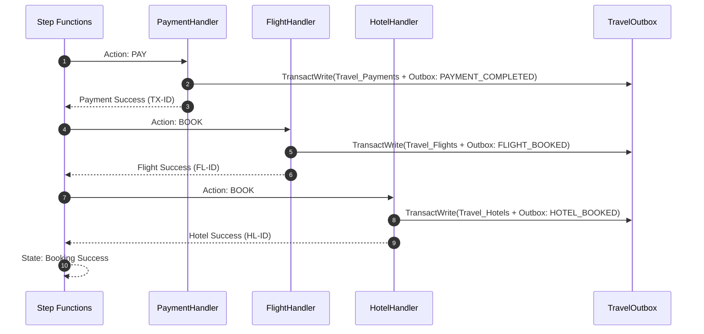
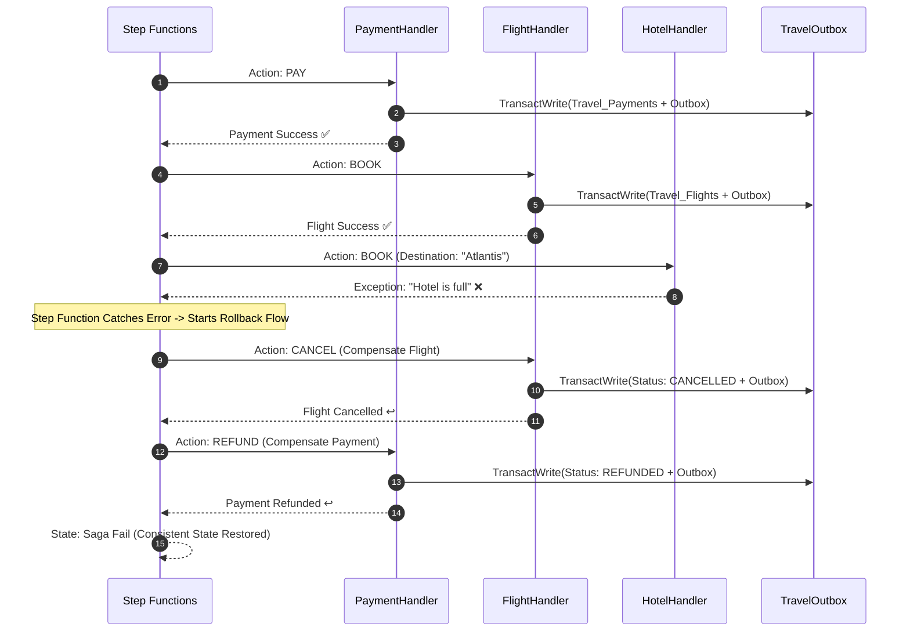

# ✈️ Serverless Distributed Travel Booking System

[](https://openjdk.org/)
[](https://spring.io/projects/spring-boot)
[](https://aws.amazon.com/)
[](https://aws.amazon.com/step-functions/)
[](https://aws.amazon.com/dynamodb/)
[](https://aws.amazon.com/sqs/)
[](https://aws.amazon.com/ses/)
[](LICENSE)

A production-grade, fault-tolerant distributed transaction system built on AWS. This project solves the **distributed data consistency** and **dual-write** challenges across serverless microservices by combining the **Payment-First Hybrid Saga Pattern** with the **Transactional Outbox Pattern**.

---

## 📑 Table of Contents
- [1. Problem Statement](#1-problem-statement)
- [2. System Architecture](#2-system-architecture)
- [3. Architectural Design Patterns](#3-architectural-design-patterns)
  - [A. Payment-First Saga Pattern](#a-payment-first-saga-pattern)
  - [B. Transactional Outbox Pattern](#b-transactional-outbox-pattern)
  - [C. Decoupled Asynchronous Notifications](#c-decoupled-asynchronous-notifications)
  - [D. Resilience & DLQ Redrive Policies](#d-resilience--dlq-redrive-policies)
- [4. Repository Structure](#4-repository-structure)
- [5. Component Breakdown](#5-component-breakdown)
- [6. Saga Workflow & Compensation Logic](#6-saga-workflow--compensation-logic)
- [7. Chaos Engineering & Failure Triggers](#7-chaos-engineering--failure-triggers)
- [8. Deployment Guide](#8-deployment-guide)
- [9. Testing Guide](#9-testing-guide)
  - [Automated Unit Testing](#automated-unit-testing)
  - [Manual End-to-End Testing](#manual-end-to-end-testing)
- [10. DLQ Monitoring & Automated Redrive](#10-dlq-monitoring--automated-redrive)

---

## 1. Problem Statement

In monolithic architectures, a travel booking (Flight + Hotel + Payment) is managed through local ACID transactions within a single relational database. In a distributed microservices architecture:
1. **Cross-Service Consistency**: Microservices maintain independent databases (`Travel_Payments`, `Travel_Flights`, `Travel_Hotels`) and cannot share distributed database locks without introducing severe bottlenecks and single points of failure.
2. **The Dual-Write Problem**: Updating local state in DynamoDB and sending a notification via email/messaging in two separate steps risks partial failures. If a crash occurs after updating the database but before publishing the event, downstream subscribers are left out of sync.
3. **Financial & Inventory Risk**: Reserving flights and hotels before securing payment risks locking up supplier inventory for transactions that subsequently fail due to insufficient funds or card declines.

This architecture resolves all three challenges through **orchestrated compensation (Saga)** and **atomic transactional outbox event streams**.

---

## 2. System Architecture

```mermaid
flowchart TD
    Client["Client / API Gateway / Spring Boot"] -->|1. Start Saga| SFN["AWS Step Functions (Orchestrator)"]

    subgraph Synchronous Booking Saga
        SFN -->|Step 1: PAY| PaymentLambda["Payment Lambda (TravelPaymentFunction)"]
        PaymentLambda -->|TransactWriteItems| DDB_Pay[("Travel_Payments")]
        PaymentLambda -->|TransactWriteItems| DDB_Outbox[("TravelOutbox")]

        SFN -->|Step 2: BOOK| FlightLambda["Flight Lambda (TravelFlightFunction)"]
        FlightLambda -->|TransactWriteItems| DDB_Flight[("Travel_Flights")]
        FlightLambda -->|TransactWriteItems| DDB_Outbox

        SFN -->|Step 3: BOOK| HotelLambda["Hotel Lambda (TravelHotelFunction)"]
        HotelLambda -->|TransactWriteItems| DDB_Hotel[("Travel_Hotels")]
        HotelLambda -->|TransactWriteItems| DDB_Outbox
    end

    subgraph Asynchronous Notification Pipeline
        DDB_Outbox -.->|DynamoDB Stream (NEW_IMAGE)| RelayLambda["Outbox Relay Lambda"]
        RelayLambda -->|Publish with Attributes| SNS["SNS Topic: TravelBookingEventsTopic"]
        SNS --> SQS["SQS Queue: TravelNotificationQueue"]
        SQS -.->|After 3 Failures| DLQ["SQS DLQ: TravelNotificationDLQ"]
        SQS --> ConsumerLambda["Notification Consumer Lambda"]
        ConsumerLambda -->|Send Email| SES["AWS SES (Email Service)"]
        SES --> UserInbox["Customer Inbox"]
    end
```

---

## 3. Architectural Design Patterns

### A. Payment-First Saga Pattern
- **Workflow Order**: `Process Payment` &rarr; `Book Flight` &rarr; `Book Hotel` &rarr; `Succeed`.
- **Financial Protection**: Funds are secured before external resources are reserved. If payment fails, execution terminates immediately with **zero** supplier reservations made.
- **Compensating Transactions**: If any downstream step fails (e.g. hotel room sold out), the Step Function catches the exception and executes reverse compensations (`UndoFlight` &rarr; `RefundPayment`) to guarantee eventual consistency.

### B. Transactional Outbox Pattern
- Solves the dual-write problem by eliminating direct calls to messaging services from business handlers.
- Whenever a worker Lambda processes an action (payment, reservation, or compensation), it issues a DynamoDB **`TransactWriteItems`** request that writes both:
  1. The **Domain Record** (e.g., `Travel_Payments`, `Travel_Flights`, or `Travel_Hotels`).
  2. An **Outbox Record** in the `TravelOutbox` table.
- Both writes succeed or fail **atomically**.
- `TravelOutbox` records include a DynamoDB **Time-To-Live (`ttl`)** set to 7 days for automated garbage collection without operational maintenance.

### C. Decoupled Asynchronous Notifications
- The synchronous booking path (Step Functions) does not block on sending emails.
- As soon as an Outbox item is committed, **DynamoDB Streams (`NEW_IMAGE`)** captures the insertion.
- The **`OutboxRelayHandler`** reads the stream batch and publishes the payload to an **AWS SNS Topic** with structured message attributes (`eventType`, `bookingId`, `eventId`).
- An **AWS SQS Queue** subscribed to the topic buffers the events.
- The **`NotificationConsumerHandler`** polls SQS, unpacks the message payload, and dispatches confirmation emails via **AWS SES**.

### D. Resilience & DLQ Redrive Policies
- **Dead Letter Queue (DLQ)**: `TravelNotificationDLQ` is attached to the notification queue with `maxReceiveCount: 3`. If SES is throttled or a payload is corrupted, the message retries 3 times before being isolated in the DLQ.
- **Monitoring**: A CloudWatch alarm (`TravelNotificationDLQAlarm`) monitors `ApproximateNumberOfMessagesVisible >= 1`.
- **Automated Redrive**: SQS Message Move Tasks allow re-processing quarantined DLQ messages back to the primary queue once the root cause is resolved.

---

## 4. Repository Structure

```
travel-booking/
├── .gitignore                           # Comprehensive root gitignore (secrets, build artifacts, IDEs)
├── README.md                            # Production architectural documentation (this file)
├── booking.json                         # Sample Step Functions execution input payload
├── instructions.md                      # Architecture requirements and checklist
│
├── infrastructure/                      # Infrastructure as Code (AWS SAM)
│   ├── template.yaml                    # DynamoDB, SQS, SNS, Lambdas, Step Functions
│   ├── step-function.json               # Payment-First Saga ASL state machine definition
│   └── README.md                        # Infrastructure deployment & DLQ redrive guide
│
├── travel-workers/                      # Serverless microservices (Java 21 AWS Lambda)
│   ├── pom.xml                          # Maven configuration (AWS SDK v2, Powertools, JUnit 5)
│   └── src/
│       ├── main/java/com/travel/workers/
│       │   ├── PaymentHandler.java              # Payment & refund handler (TransactWriteItems)
│       │   ├── FlightHandler.java               # Flight booking & cancellation handler
│       │   ├── HotelHandler.java                # Hotel booking & cancellation handler
│       │   ├── OutboxHelper.java                # Outbox schema & atomic Put builder
│       │   ├── OutboxRelayHandler.java          # DynamoDB Streams -> SNS Relay Lambda
│       │   └── NotificationConsumerHandler.java # SQS -> SES Consumer Lambda
│       └── test/java/com/travel/workers/
│           ├── WorkersOutboxTest.java           # Unit tests for atomic TransactWriteItems
│           ├── OutboxRelayHandlerTest.java      # Unit tests for Stream to SNS relay
│           └── NotificationConsumerHandlerTest.java # Unit tests for SQS to SES consumer
│
└── travel-api/                          # Spring Boot 3 REST API intake service
    ├── pom.xml                          # Maven configuration
    └── src/
        └── main/
            ├── java/com/travel/api/             # Spring Boot controller & service
            └── resources/
                └── application.properties.example # Safe configuration template
```


## 5. Component Breakdown

| Component | Class / File | Purpose & Responsibilities |
| :--- | :--- | :--- |
| **Payment Service** | [`PaymentHandler.java`](file:///c:/Users/akshr/OneDrive/Desktop/travel-booking/travel-workers/src/main/java/com/travel/workers/PaymentHandler.java) | Processes credit card charges and issues refunds. Writes atomically to `Travel_Payments` and `TravelOutbox` (`PAYMENT_COMPLETED`, `PAYMENT_REFUNDED`). |
| **Flight Service** | [`FlightHandler.java`](file:///c:/Users/akshr/OneDrive/Desktop/travel-booking/travel-workers/src/main/java/com/travel/workers/FlightHandler.java) | Reserves flights and executes cancellations. Writes atomically to `Travel_Flights` and `TravelOutbox` (`FLIGHT_BOOKED`, `FLIGHT_CANCELLED`). |
| **Hotel Service** | [`HotelHandler.java`](file:///c:/Users/akshr/OneDrive/Desktop/travel-booking/travel-workers/src/main/java/com/travel/workers/HotelHandler.java) | Reserves hotel rooms and executes cancellations. Writes atomically to `Travel_Hotels` and `TravelOutbox` (`HOTEL_BOOKED`, `HOTEL_CANCELLED`). |
| **Outbox Utility** | [`OutboxHelper.java`](file:///c:/Users/akshr/OneDrive/Desktop/travel-booking/travel-workers/src/main/java/com/travel/workers/OutboxHelper.java) | Encapsulates the schema (`eventId`, `bookingId`, `eventType`, `payload`, `createdAt`, `ttl`) and generates `TransactWriteItem` payloads. |
| **Outbox Relay** | [`OutboxRelayHandler.java`](file:///c:/Users/akshr/OneDrive/Desktop/travel-booking/travel-workers/src/main/java/com/travel/workers/OutboxRelayHandler.java) | Reads DynamoDB Stream `NEW_IMAGE` events on `INSERT` and dispatches messages to the central SNS Topic. |
| **Notification Consumer** | [`NotificationConsumerHandler.java`](file:///c:/Users/akshr/OneDrive/Desktop/travel-booking/travel-workers/src/main/java/com/travel/workers/NotificationConsumerHandler.java) | Consumes SQS records, unwraps SNS envelopes, and triggers AWS SES to deliver formatted HTML/text booking confirmation emails. |
| **State Machine** | [`step-function.json`](file:///c:/Users/akshr/OneDrive/Desktop/travel-booking/infrastructure/step-function.json) | ASL definition orchestrating the payment-first saga and routing rollbacks via `Catch` blocks. |
| **Infrastructure** | [`template.yaml`](file:///c:/Users/akshr/OneDrive/Desktop/travel-booking/infrastructure/template.yaml) | AWS SAM template provisioning all DynamoDB tables, SNS, SQS, DLQ, CloudWatch alarms, and Lambdas. |

---

## 6. Saga Workflow & Compensation Logic

### Happy Path (All Steps Succeed)


### Failure Path (Hotel Full & Compensation Rollback)


---

## 7. Chaos Engineering & Failure Triggers

The system contains built-in determinism triggers for demonstrating resilience, rollbacks, and error handling:

| Scenario | Input Condition | Triggered Behavior | Rollback Result |
| :--- | :--- | :--- | :--- |
| **Card Decline / Over Limit** | `"amount": 1500` (any value `> 1000`) | `PaymentHandler` throws exception immediately. | Saga halts at `Payment Fail`. No flights or hotels are reserved. |
| **Flight Service Failure** | `"destination": "Mars"` | `FlightHandler` throws exception. | Step Function catches error &rarr; triggers `Refund Payment` &rarr; `Saga Fail`. |
| **Hotel Unavailable** | `"destination": "Atlantis"` | `HotelHandler` throws exception. | Step Function catches error &rarr; triggers `Undo Flight` &rarr; triggers `Refund Payment` &rarr; `Saga Fail`. |

---

## 8. Deployment Guide

### Option 1: Automated Deployment via AWS SAM (Recommended)
1. **Build and package the Java workers**:
   ```bash
   cd travel-workers
   mvn clean package
   ```
2. **Deploy infrastructure**:
   ```bash
   cd infrastructure
   sam build
   sam deploy --guided
   ```
   SAM will provision all DynamoDB tables, SNS topics, SQS queues (with DLQ), Lambdas, triggers, and the Step Function state machine.

### Option 2: Manual Console Deployment
1. **Package the Uber-JAR**:
   ```bash
   cd travel-workers
   mvn clean package
   ```
2. **Upload JAR to AWS Lambda Functions**:
   Upload `target/travel-workers-1.0-SNAPSHOT.jar` to each Lambda:
   - `TravelPaymentFunction`: `com.travel.workers.PaymentHandler::handleRequest`
   - `TravelFlightFunction`: `com.travel.workers.FlightHandler::handleRequest`
   - `TravelHotelFunction`: `com.travel.workers.HotelHandler::handleRequest`
   - `TravelOutboxRelayFunction`: `com.travel.workers.OutboxRelayHandler::handleRequest`
   - `TravelNotificationConsumerFunction`: `com.travel.workers.NotificationConsumerHandler::handleRequest`
3. **Configure DynamoDB `TravelOutbox`**:
   - Partition Key: `eventId` (String `S`).
   - Enable **DynamoDB Streams** (`New image`).
   - Enable **TTL** on attribute `ttl`.
4. **Deploy State Machine**:
   - Create a State Machine in AWS Step Functions.
   - Paste the contents of [`infrastructure/step-function.json`](file:///c:/Users/akshr/OneDrive/Desktop/travel-booking/infrastructure/step-function.json).

---

## 9. Testing Guide

### Automated Unit Testing
The project includes a comprehensive test suite using **JUnit 5** and **Mockito**:
```bash
cd travel-workers
mvn test
```
**Test Coverage Includes:**
- Verification of atomic `TransactWriteItems` across domain tables and `TravelOutbox`.
- Verification of `OutboxHelper` schema and 7-day TTL generation.
- DynamoDB Stream record filtering (`INSERT` vs `MODIFY`) and SNS message attribute mapping.
- SQS message parsing, SNS envelope un-wrapping, and SES email payload creation.
- DLQ exception re-throwing for failed deliveries.

### Manual End-to-End Testing
Navigate to **AWS Step Functions Console** &rarr; Select your State Machine &rarr; Click **Start execution**.

#### Test A: Success Case (Happy Path)
```json
{
  "userId": "user-101",
  "userEmail": "xyz@gmail.com",
  "destination": "Paris",
  "amount": 250,
  "bookingId": "bk-manual-001"
}
```

#### Test B: Hotel Sold Out (Full Rollback Verification)
```json
{
  "userId": "user-102",
  "userEmail": "xyz@gmail.com",
  "destination": "Atlantis",
  "amount": 300,
  "bookingId": "bk-manual-002"
}
```

#### Test C: Flight Unavailable (Partial Rollback Verification)
```json
{
  "userId": "user-103",
  "userEmail": "xyz@gmail.com",
  "destination": "Mars",
  "amount": 400,
  "bookingId": "bk-manual-003"
}
```

---

## 10. DLQ Monitoring & Automated Redrive

If a message fails delivery 3 times, it is redirected to `TravelNotificationDLQ`.

### 1. View Quarantined Messages
```bash
aws sqs receive-message \
  --queue-url <TravelNotificationDLQ_URL> \
  --attribute-names All \
  --max-number-of-messages 10
```

### 2. Execute Automated Redrive
To move all messages from the DLQ back to the active queue for reprocessing:
```bash
aws sqs start-message-move-task \
  --source-arn <TravelNotificationDLQ_ARN> \
  --destination-arn <TravelNotificationQueue_ARN>
```

### 3. Check Redrive Status
```bash
aws sqs list-message-move-tasks \
  --source-arn <TravelNotificationDLQ_ARN>
```
*(Alternatively, click the **"Start DLQ redrive"** button directly in the AWS SQS Web Console).*

---

## 📄 License
This project is licensed under the MIT License - see the LICENSE file for details.
