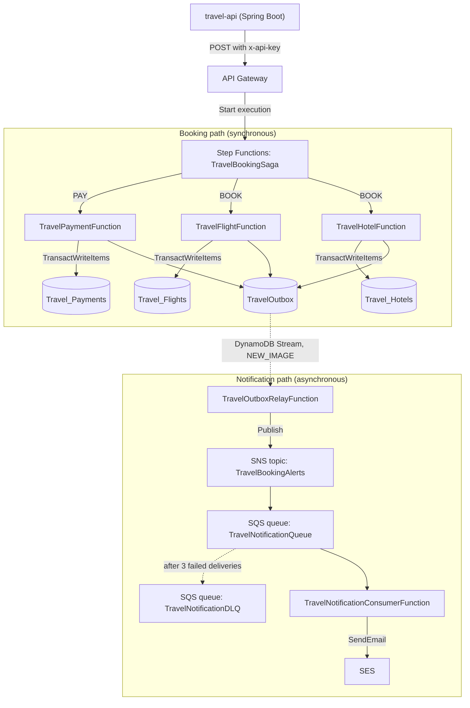
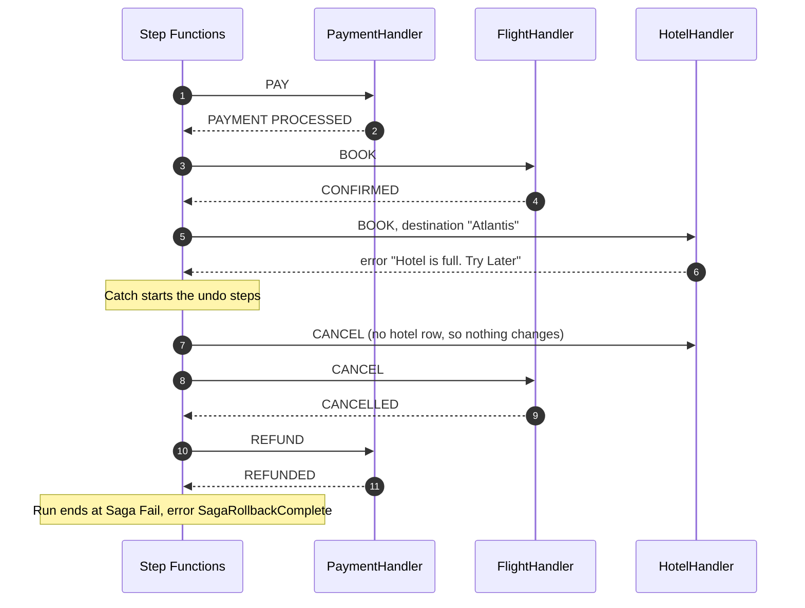

# Distributed travel booking saga

[](https://github.com/Aksh9203/Distributed-Travel-Booking-Saga/actions/workflows/ci.yml)
[](https://openjdk.org/)
[](https://spring.io/projects/spring-boot)
[](https://aws.amazon.com/step-functions/)
[](https://aws.amazon.com/dynamodb/)
[](LICENSE)

A travel booking that runs as three AWS Lambda functions: one takes the payment, one books the flight, and one books the hotel. AWS Step Functions calls them in that order. When a later step fails, the state machine undoes the steps that already finished.

Each step writes its business record and an event record in one DynamoDB transaction. A separate pipeline reads the event records and emails the customer through SNS, SQS, and SES.

The payment, flight, and hotel services are simulations. No card is charged and no supplier is called. Fixed inputs make a step fail, so you can watch a rollback. See [Failure triggers](#failure-triggers).

The live deployment in `us-east-1` was created by hand in the AWS console. The AWS SAM template in `infrastructure/template.yaml` has never been deployed. See [Known limitations](#known-limitations).

## Contents

- [The problem](#the-problem)
- [Architecture](#architecture)
- [How the saga runs](#how-the-saga-runs)
- [How events become emails](#how-events-become-emails)
- [Failure triggers](#failure-triggers)
- [Known limitations](#known-limitations)
- [Repository layout](#repository-layout)
- [Build and test](#build-and-test)
- [Run travel-api](#run-travel-api)
- [Deploy](#deploy)
- [License](#license)

## The problem

One booking touches three services, and each service owns its own table: `Travel_Payments`, `Travel_Flights`, and `Travel_Hotels`. No single database transaction covers all three. This design has to handle three problems:

1. **Partial bookings.** The payment can succeed and the hotel can then fail. Something has to refund the payment and cancel the flight.
2. **Dual writes.** A service that saves a record and then publishes an event can crash between the two calls. The record then exists, but no one hears about it.
3. **Reservations for unpaid bookings.** If the flight and hotel are booked before the payment, a declined card leaves reservations that someone has to cancel.

The design answers the first problem with a saga, the second with a transactional outbox, and the third by taking the payment first.

## Architecture



## How the saga runs

### Payment first

The state machine definition is in [`infrastructure/step-function.json.example`](infrastructure/step-function.json.example). It starts at `Process Payment`, then runs `Book Flight`, then `Book Hotel`, and ends at `Booking Success`.

The payment runs first so that a declined payment ends the run before any flight or hotel is booked. In that case the run ends at `Payment Fail` with the error `PaymentError`, and no table has a new row.

### Compensation

Each booking step has a `Catch` that starts the undo steps for everything that ran before it, in reverse order:

| Failed step | Undo steps that run |
| :--- | :--- |
| `Book Flight` | `Undo Flight`, then `Refund Payment` |
| `Book Hotel` | `Undo Hotel`, then `Undo Flight`, then `Refund Payment` |

The undo steps also cover the step that failed. A Lambda function can commit its write and then fail before it returns, so the state machine cannot tell whether the failed step wrote anything. An undo step on a booking that was never written does nothing. The cancel uses a DynamoDB condition, `attribute_exists(booking_id)`, so it writes no row and no event.

Each undo step retries up to 6 times on any error. The waits start at 1 second and double each time. If `Undo Hotel` or `Undo Flight` still fails, `Refund Payment` runs anyway, so the customer gets the money back. The run then ends in one of two ways:

- **`SagaRollbackComplete`.** Every undo step succeeded. The records are consistent.
- **`CompensationFailed`.** At least one undo step failed after all its retries. A person has to repair the records. The live deployment emails an operations address for these runs through an EventBridge rule.



### Transactional outbox

Every action, including each undo, sends one DynamoDB `TransactWriteItems` request with two items:

1. The business record in `Travel_Payments`, `Travel_Flights`, or `Travel_Hotels`.
2. An event record in `TravelOutbox`.

DynamoDB applies both items or neither. A crash cannot leave a business record without its event.

[`OutboxHelper`](travel-workers/src/main/java/com/travel/workers/OutboxHelper.java) builds the event record. It has the attributes `eventId`, `bookingId`, `eventType`, `payload`, `createdAt`, and `ttl`. The `ttl` is 7 days after `createdAt`, so DynamoDB deletes old event records when TTL is enabled on the table.

## How events become emails

The booking path does not wait for email. The state machine has no SNS or SES step.

1. The `TravelOutbox` table streams each new item (`NEW_IMAGE`) to [`OutboxRelayHandler`](travel-workers/src/main/java/com/travel/workers/OutboxRelayHandler.java).
2. The relay skips every stream record that is not an `INSERT`. It publishes the payload to SNS with the message attributes `eventType`, `bookingId`, and `eventId`.
3. `TravelNotificationQueue` is subscribed to the topic.
4. [`NotificationConsumerHandler`](travel-workers/src/main/java/com/travel/workers/NotificationConsumerHandler.java) reads batches from the queue, removes the SNS envelope, and sends an HTML and text email through SES. It escapes every payload field before it puts the field in the HTML.

A message with no `userEmail` is skipped. When one send fails, the consumer reports only that message as failed (`ReportBatchItemFailures`). SQS then delivers only that message again. After 3 failed deliveries, SQS moves the message to `TravelNotificationDLQ`.

Moving messages from the DLQ back to the main queue is a manual step. See [Redrive the DLQ](infrastructure/README.md#redrive-the-dlq).

## Failure triggers

These inputs make a step fail on purpose:

| Input | What fails | How the run ends |
| :--- | :--- | :--- |
| `"amount"` above `1000` | `PaymentHandler` throws before it writes anything | `Payment Fail`, error `PaymentError`. No rows. |
| `"destination": "Mars"` | `FlightHandler` throws | `Undo Flight` does nothing, `Refund Payment` runs, and the run ends at `Saga Fail` with `SagaRollbackComplete` |
| `"destination": "Atlantis"` | `HotelHandler` throws | `Undo Hotel` does nothing, `Undo Flight` and `Refund Payment` run, and the run ends at `Saga Fail` with `SagaRollbackComplete` |

An amount of exactly `1000` is accepted.

## Known limitations

- **No idempotency.** A second booking with the same `bookingId` overwrites the first payment record. If that second booking then fails, the refund marks the first booking as refunded.
- **The relay can lose events.** The SAM template's stream mapping retries a failed batch 3 times and has no `OnFailure` destination. After the retries run out, those records are dropped.
- **The relay can send an event twice.** A retried batch publishes again the records that already went out, so a customer can get a duplicate email.
- **Missing input fields fail the run before any step.** If the input has no `destination`, for example, Step Functions raises `States.Runtime`. A `Catch` cannot handle that error. The run fails at `Process Payment` without calling the Lambda function, so nothing is written.
- **The SAM template is unverified.** It has never been deployed. Four problems are known:
  - It points at `step-function.json`, which is gitignored, so the file is missing.
  - The ARNs in the `.example` file do not match the template's function names, which end in `-${Environment}`.
  - It sets `AWS_REGION`, which Lambda reserves. Deployment is expected to fail. This comes from the AWS documentation and was not tried.
  - It creates no API Gateway, so `travel-api` has nothing to call.
- **The template's DLQ alarm notifies no one.** `TravelNotificationDLQAlarm` has no `AlarmActions`.
- **The tests mock AWS.** No test calls a real AWS service. `SagaCompensationTest` runs the real state machine definition against the real handlers, but it uses a small interpreter in the test code. That interpreter understands only `States.ALL` errors.

## Repository layout

The tree below matches `git ls-files` with the IDE files left out.

```
.
├── .github/workflows/ci.yml          # Runs mvn -B verify for both Maven projects
├── LICENSE
├── README.md
├── booking.json                      # Sample state machine input
├── infrastructure/
│   ├── README.md                     # Deployment steps and DLQ redrive
│   ├── step-function.json.example    # State machine definition (Amazon States Language)
│   └── template.yaml                 # AWS SAM template, never deployed
├── travel-api/                       # Spring Boot 4 app that forwards bookings to API Gateway
│   ├── mvnw, mvnw.cmd, pom.xml
│   └── src/
│       ├── main/java/com/travel/api/
│       │   ├── TravelApiApplication.java
│       │   ├── config/CorsConfig.java
│       │   ├── controller/BookingController.java
│       │   ├── dto/BookingRequest.java
│       │   └── service/TravelService.java
│       ├── main/resources/application.properties.example
│       └── test/java/com/travel/api/TravelApiApplicationTests.java
└── travel-workers/                   # Java 21 Lambda handlers
    ├── pom.xml
    └── src/
        ├── main/java/com/travel/workers/
        │   ├── PaymentHandler.java
        │   ├── FlightHandler.java
        │   ├── HotelHandler.java
        │   ├── OutboxHelper.java
        │   ├── OutboxRelayHandler.java
        │   └── NotificationConsumerHandler.java
        └── test/java/com/travel/workers/
            ├── CancelNothingBookedTest.java
            ├── CompensationNotificationTest.java
            ├── HandlerActionTest.java
            ├── NotificationConsumerHandlerTest.java
            ├── OutboxRelayHandlerTest.java
            ├── PaymentAmountTest.java
            ├── SagaCompensationTest.java
            └── WorkersOutboxTest.java
```

## Build and test

You need Java 21 and Maven 3.9 or later. Run each project's tests from its own directory:

```bash
cd travel-workers
mvn -B verify
cd ../travel-api
mvn -B verify
```

CI runs the same two commands on every pull request and on every push to `main`. The worker tests check these things:

- `SagaCompensationTest` runs the state machine definition against the real handlers and an in-memory DynamoDB mock. It covers the success path, each failure trigger, and undo steps that fail once or keep failing.
- `WorkersOutboxTest` checks that a payment, a refund, a flight booking, and a hotel booking each send one `TransactWriteItems` request with the business record and the event record. It also checks that `ttl` is 7 days after `createdAt`.
- `OutboxRelayHandlerTest` checks that the relay publishes `INSERT` records with the three message attributes, and skips `MODIFY` records.
- `NotificationConsumerHandlerTest` checks SNS envelope removal, HTML escaping, skipped messages with no email, and per-message failure reports.
- `PaymentAmountTest`, `HandlerActionTest`, `CompensationNotificationTest`, and `CancelNothingBookedTest` check decimal amounts, unknown actions, emails for undo events, and undo steps on bookings that were never written.

## Run travel-api

`travel-api` accepts `POST /api/book` and forwards the JSON body to the API Gateway URL in `aws.api.url`. It sends `aws.api.key` in the `x-api-key` header.

1. Copy `travel-api/src/main/resources/application.properties.example` to `application.properties` in the same directory. Git ignores that file.
2. Set the environment variables `AWS_API_URL` and `AWS_API_KEY`, or write the values into `application.properties`.
3. Start the app from the `travel-api` directory:
   ```bash
   ./mvnw spring-boot:run
   ```
   On Windows, run `mvnw.cmd spring-boot:run`.
4. Send a booking to port 8080:
   ```bash
   curl -X POST http://localhost:8080/api/book \
     -H "Content-Type: application/json" \
     -d '{"bookingId":"bk-001","userId":"user-101","userEmail":"you@example.com","destination":"Paris","amount":250}'
   ```

## Deploy

[`infrastructure/README.md`](infrastructure/README.md) has the steps for deploying by hand in the AWS console, checking the deployment, and moving messages out of the DLQ.

## License

[MIT](LICENSE)
